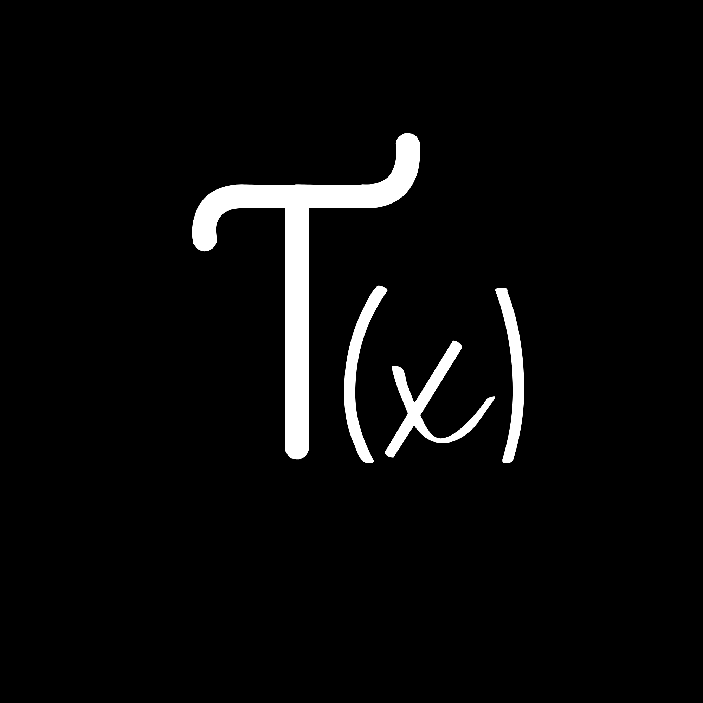
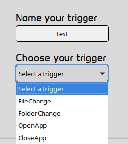
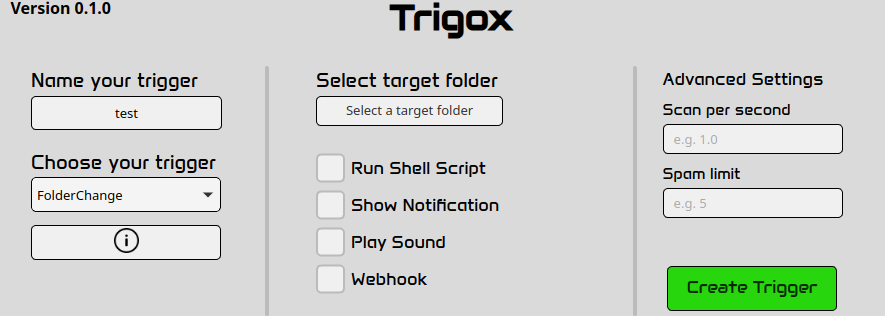
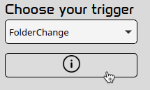
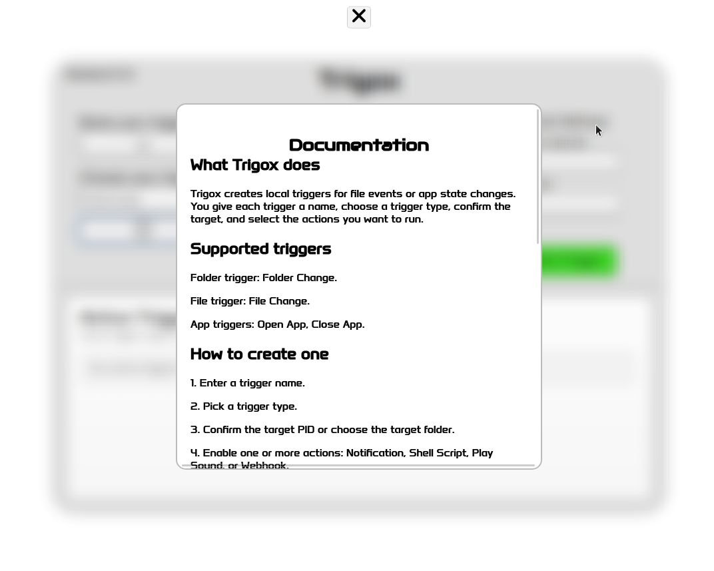
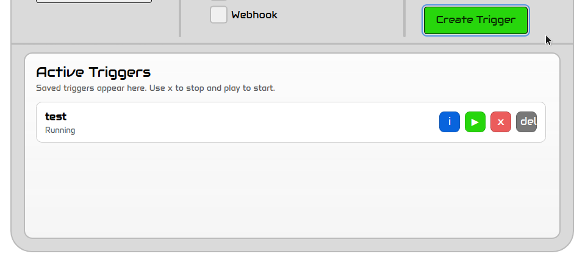
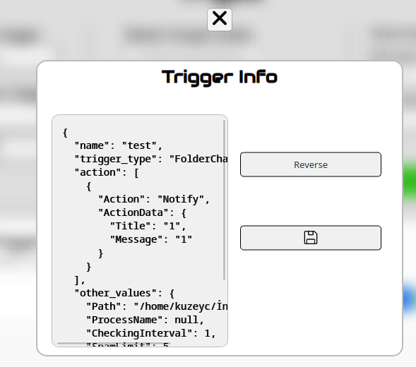

# Trigox 0.1.0 FULL

## What is Trigox?

Basically **Trigox** is a fully async Computer watcher (yeah a lil goofy describing)

## How is it works?

When your selected **Condition** is fires **Actions** are runs.

**Actions** are selected by user in creating trigger phase.

## Create your first trigger with that document!

| STEP | Usage |
| --- |  ---  |
| 1) Choosing trigger type | |
| 2) Configuring trigger   | |
| 3) If you wanting to see webhook doc and others | |
| 4) Checking doc page | |
| 5) After creating trigger | |
| 6) Making changes after creating trigger | |

## Used TECHS
| Tech | Where |
| --- |  ---  |
| Vanilla CSS, HTML, TS | Frontend and talking with rust side |
| Tauri | Bridge between states, frontend and backend |
| Rust | Creating ,listening triggers and talking with typescript side |

## Used AIs

| LLM | Usage |
| --- |  ---  |
| Copilot | pressing tab :D |
| Gemini | For Researchs |
